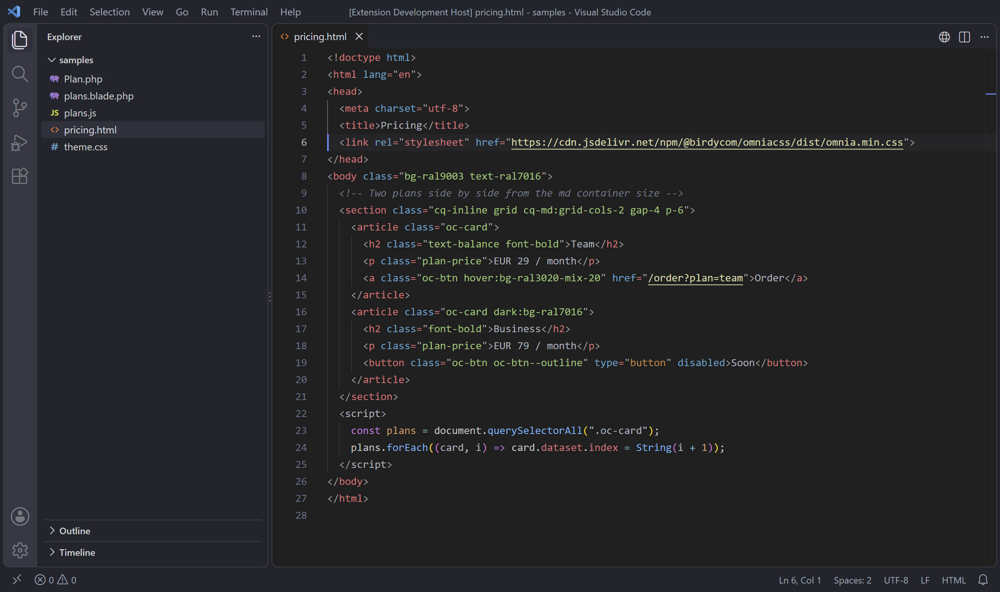
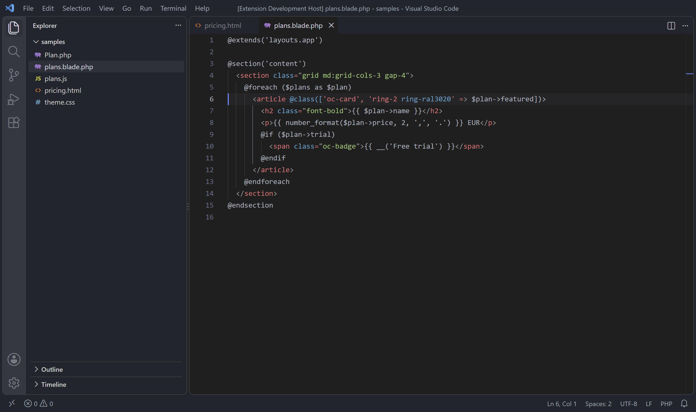
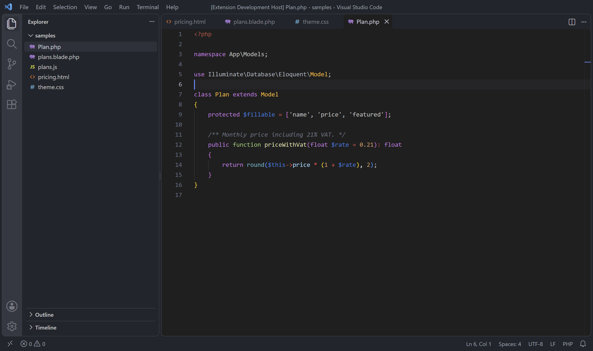
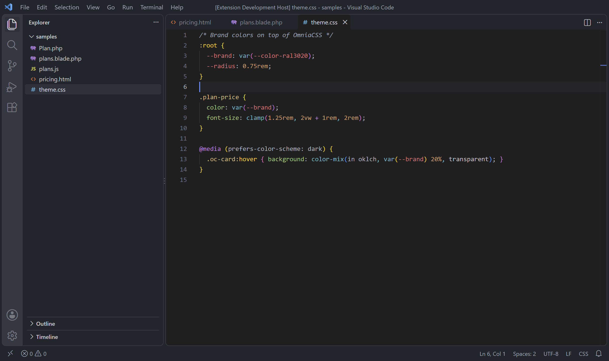
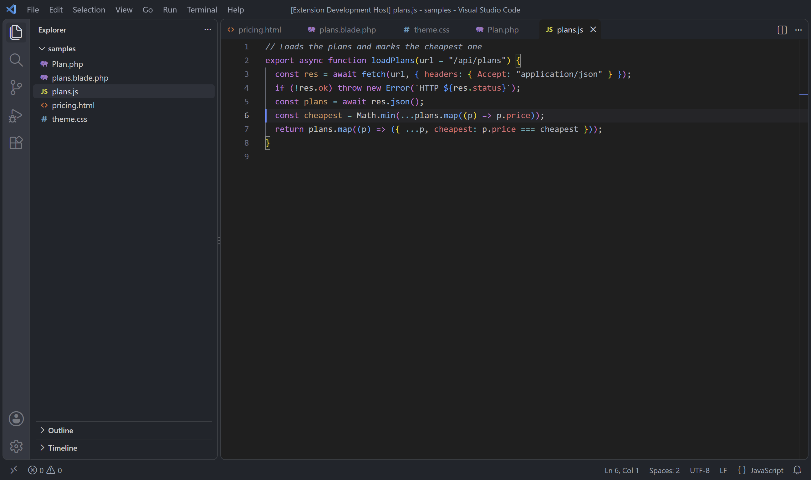

# Omnia Theme

A calm dark theme for VS Code and Cursor, made by [Birdycom](https://birdycom.be) and used every day for HTML, Blade, PHP, CSS and JavaScript work. Muted backgrounds, clear syntax colors and a soft contrast that stays easy on the eyes during long sessions.



## Install

| Editor | Where |
|---|---|
| VS Code | [VS Code Marketplace](https://marketplace.visualstudio.com/items?itemName=Birdycom.omnia-theme), or search *Omnia Theme* in the Extensions view |
| Cursor, VSCodium, Windsurf | [Open VSX](https://open-vsx.org/extension/Birdycom/omnia-theme), the same search in the Extensions view |

Then open the Command Palette (<kbd>Ctrl</kbd> <kbd>Shift</kbd> <kbd>P</kbd>), choose **Preferences: Color Theme** and pick **Omnia Theme Main**.

```bash
code --install-extension Birdycom.omnia-theme     # VS Code
cursor --install-extension Birdycom.omnia-theme   # Cursor
```

## Languages

Colors were tuned by hand for the languages of a typical web project:

| | |
|---|---|
| **HTML** and templates | tags, attributes, class strings and inline `<script>` / `<style>` |
| **PHP and Blade** | directives, `@class([...])`, `{{ }}` echoes, models and type hints |
| **CSS, SCSS, Less** | selectors, custom properties, at-rules and units |
| **JavaScript, JSON, YAML, Markdown, Python** | keywords, strings, keys and headings |

### Blade



### PHP



### CSS



### JavaScript



## With OmniaCSS

Omnia Theme pairs with [OmniaCSS IntelliSense](https://marketplace.visualstudio.com/items?itemName=Birdycom.omniacss-intellisense): autocomplete, hover CSS and color swatches for every [OmniaCSS](https://omniacss.eu) utility and [OmniaUI](https://omniaui.eu) class. The theme works just as well without it.

## Your own tweaks

Any color can be overridden in your `settings.json` without changing the theme:

```jsonc
{
  "workbench.colorCustomizations": {
    "[Omnia Theme Main]": { "editor.background": "#1b1d21" }
  },
  "editor.tokenColorCustomizations": {
    "[Omnia Theme Main]": { "comments": "#7f848e" }
  }
}
```

The theme sets no font. A monospaced font with ligatures, such as Cascadia Code or Fira Code, suits it well: `"editor.fontFamily": "Cascadia Code, Consolas, monospace"`.

## Building it yourself

```bash
npm install
npm run icon          # media/icon.svg -> media/icon.png
npm run screenshots   # the README pictures, taken in real VS Code with the theme loaded (needs VS Code and Chrome or Edge)
npm run package       # omnia-theme-<version>.vsix
```

A new version is published by pushing a tag `v<version>` that matches `package.json`.

## Credits

Omnia Theme started from [One Dark](https://github.com/akamud/vscode-theme-onedark) by Mahmoud Ali, itself based on Atom's One Dark, and was then reworked by Birdycom. Both are MIT licensed; see [LICENSE](LICENSE).

MIT © Birdycom
